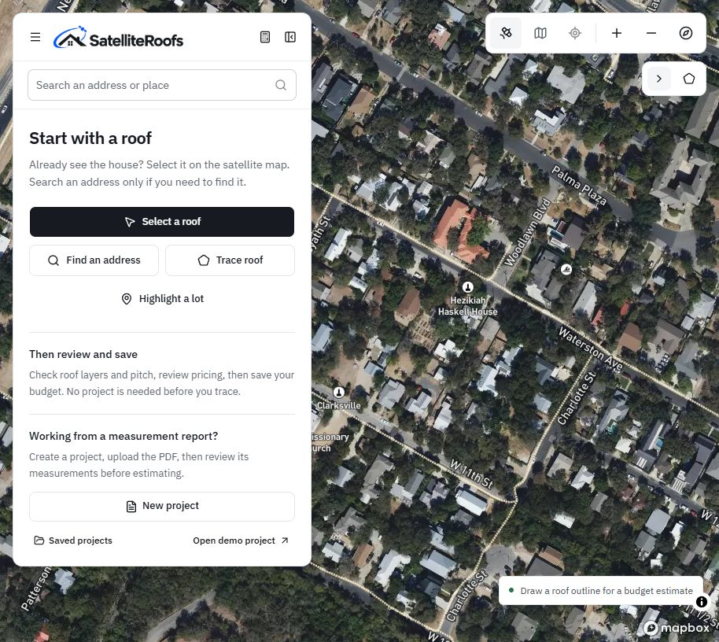
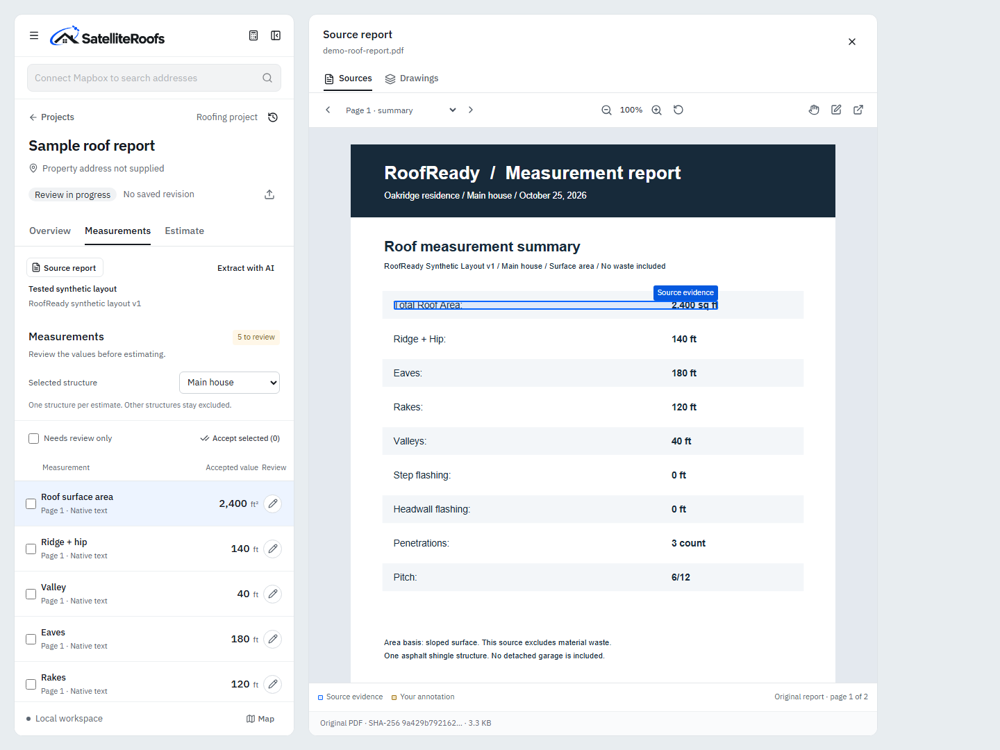
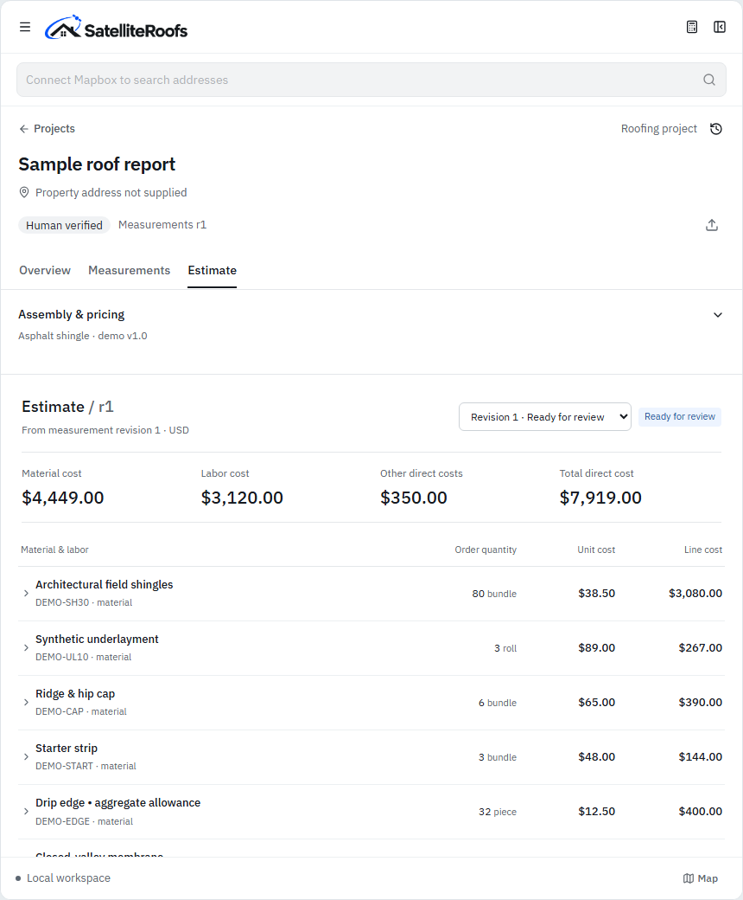

<div align="center">
  <h1>SatelliteRoofs</h1>
  <p><strong>From a roofing report to a reviewed, explainable estimate.</strong></p>
  <p>Python · FastAPI · Next.js · PostgreSQL · PDF processing</p>
</div>

[](https://github.com/rod-jemeel/satelliteroofs/actions/workflows/ci.yml)

SatelliteRoofs is a local-first roofing measurement review and estimating prototype. It brings the original PDF, extracted measurements, human corrections, material calculations and estimate revisions into one workspace. An optional satellite map supports preliminary roof sketches and layered budgets.

**Status:** working prototype, not a production quoting service. The screenshots and recorded PDF walkthrough use synthetic report data and demonstration prices. Real measurement-provider reports have not yet been validated.

[Watch the recorded walkthrough](https://raw.githubusercontent.com/rod-jemeel/satelliteroofs/main/docs/media/walkthrough.mp4) · [Sample PDF](fixtures/demo-roof-report.pdf) · [Architecture](docs/architecture.md) · [Known limits](docs/limitations.md)



## The main workflow

1. Create a project and upload a text-based roofing measurement PDF.
2. Review extracted area, pitch and edge lengths beside the source evidence.
3. Correct values, document the reason, save a revision and verify it.
4. Calculate material quantities and labor using explicit formulas and configured rates.
5. Inspect calculation traces, approve the estimate and export a customer proposal.

AI is optional. Native PDF extraction, manual review, calculation and PDF export work without AI or Mapbox credentials. AI interpretation does not perform the estimating mathematics.



## What works today

| Capability | Implementation |
| --- | --- |
| PDF processing | Native-text extraction with source page/token evidence; explicit missing/conflicting values |
| Review | Editable measurements, correction reasons, immutable revisions and separate human verification |
| Material calculations | Decimal-based quantities, coverage, package rounding, waste, labor, margin/markup and tax |
| Estimates | Calculation traces, explained overrides, approval gates and separate customer/internal exports |
| Map budgets | Optional building selection, editable roof sections, assumed pitch, per-layer colors and overlap order |
| Address navigation | Optional Mapbox Search Box and temporary geocoding; permanent geocoding is blocked |
| Parcel highlighting | Public NJOGIS parcel lookup in its covered area; other locations report missing coverage |
| AI | Optional user-owned sign-in, source-linked extraction and reviewed supplier-price research |

The material assembly is a demonstration configuration. Manufacturer-specific coverage, local labor rules, product compatibility, actual prices and job scope must be reviewed before business use. Scanned PDFs need manual entry. JobNimbus records are mocked; production handoff automation is not implemented.



## Run locally

The supported launcher is Windows. Use **Node.js 22+**, **Python 3.12**, Git, and PowerShell. The application provisions a dedicated embedded PostgreSQL instance; Docker is not required.

```powershell
git clone https://github.com/rod-jemeel/satelliteroofs.git
cd satelliteroofs
powershell -NoProfile -ExecutionPolicy Bypass -File scripts/setup.ps1
npm.cmd run dev
```

Open **http://127.0.0.1:3210** and keep the launcher running. For a credential-free first run, choose **Open demo project**, or create a project and upload `fixtures/demo-roof-report.pdf`.

For a background production build:

```powershell
npm.cmd run build
powershell -NoProfile -File scripts/start-background.ps1
# Stop only this installation:
powershell -NoProfile -File scripts/stop.ps1
```

The web app, private API and database listen on loopback ports **3210**, **8137** and **55439**. Do not expose this local prototype directly to the internet. It has a local-owner session model, not hosted multi-user authentication.

## Optional services and costs

- **Mapbox:** add your own public token in Settings for maps and address navigation. Usage is subject to the provider's billing; the app does not enforce an account-wide spending cap. Temporary search results are not stored as project addresses.
- **AI:** connect your own eligible account and test your selected model. AI extraction and price research are explicit actions and may consume provider usage. Supplier results require source review before applying.
- **Parcel data:** the current public data adapter covers New Jersey. It is not nationwide parcel coverage and its boundaries are reference geometry, not survey measurements.

No credentials, account sessions, uploaded user reports or local databases are included in this repository. The demo video blocks external requests and does not run AI or supplier searches.

## Development and verification

```powershell
.venv/Scripts/python.exe -m pytest tests -q
npm.cmd run test:geometry
npm.cmd run build
# With the local app and worker running:
npx.cmd playwright install chromium
npm.cmd run test:e2e
# Record the synthetic PDF walkthrough without external calls:
npm.cmd run demo:record
```

The recorder writes WebM. Set `FFMPEG_PATH` to an existing FFmpeg executable with H.264 support to also produce the shareable MP4.

Browser tests stub Mapbox and AI responses and create their own synthetic projects. Backend tests use a separate SQLite test database. GitHub Actions checks backend tests, geometry tests and the frontend build. Provider acceptance and clean installation remain separate from unit-test results; see [limitations](docs/limitations.md).

## Repository layout

```text
apps/web/          Next.js UI and same-origin API proxy
services/api/rr/   FastAPI, validation, PDF extraction and calculation modules
services/worker/   Bounded background PDF processing
packages/contracts/  Shared/generated API contracts
migrations/        Database schema migrations
fixtures/          Redistributable synthetic PDF reports
tests/             Backend, geometry and browser checks
docs/              Architecture, limitations and demo media
scripts/           Setup, launch, stop and demo recording
```

## Security and attribution

Use synthetic or authorized reports only. Keep `.runtime/`, `.env*`, virtual environments and local uploads private. See [SECURITY.md](SECURITY.md) for deployment boundaries and reporting vulnerabilities.

Map imagery retains Mapbox attribution. Parcel data is credited to NJOGIS and its county/municipal contributors. Third-party software retains its own licenses; see [dependency notices](docs/third-party/DEPENDENCIES.md). Legacy `ROOFREADY_*` environment names remain for compatibility with existing local installations.

Copyright © 2026 rod-jemeel. Source is published for review; no general reuse license is granted. See [LICENSE](LICENSE). Public GitHub contents can still be viewed, forked and downloaded.
