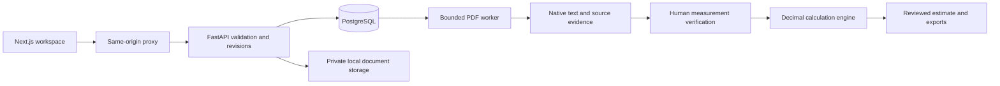

# Architecture

SatelliteRoofs is a single-owner, local application. The supported Windows launcher starts an isolated PostgreSQL database, a FastAPI API, one PDF worker and a Next.js web process. Only the web origin is intended for browser interaction.

## Boundaries

- `documents.py` reads native PDF text, normalizes candidate measurements and retains source locations. Missing or ambiguous values remain unresolved.
- `ai_gateway.py` optionally interprets prepared text using a user-owned connection. Its output remains candidates for review. It never approves a revision.
- `measurements.py` handles canonical units and validation. `estimates.py` uses decimal arithmetic for material demand, packages, labor and selling price.
- Revision sequence checks reject stale writes. Changing measurement inputs requires a new estimate; an older approval is not silently transferred.
- `RoofDrawControl` and `roof_sections.py` manage preliminary horizontal roof geometry, assumed pitch and overlap order. These sketches do not create verified ridge/eave measurements.
- `price_research.py` keeps source links, explicit review and durable request states. Ambiguous external requests are not automatically replayed.
- Mapbox temporary results stay in the current navigation workflow. Independently supplied addresses may be saved. Permanent geocoding is disabled.
- `parcels.py` queries a fixed public NJOGIS service, returns limited parcel identifiers and geometry containing the selected point, and excludes owner attributes. Parcel geometry never feeds roofing quantities.

## Local security model

The API requires an installation-only proxy key. Mutations also validate the local session, origin and CSRF token. OAuth credentials are stored outside Git and protected with Windows DPAPI on Windows. PDF inspection runs in a child process with resource/time limits. These controls support local use; they do not replace hosted identity, tenant isolation, authorization, operational monitoring or a production security review.
